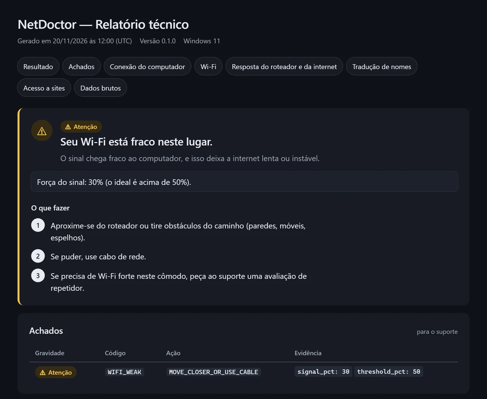
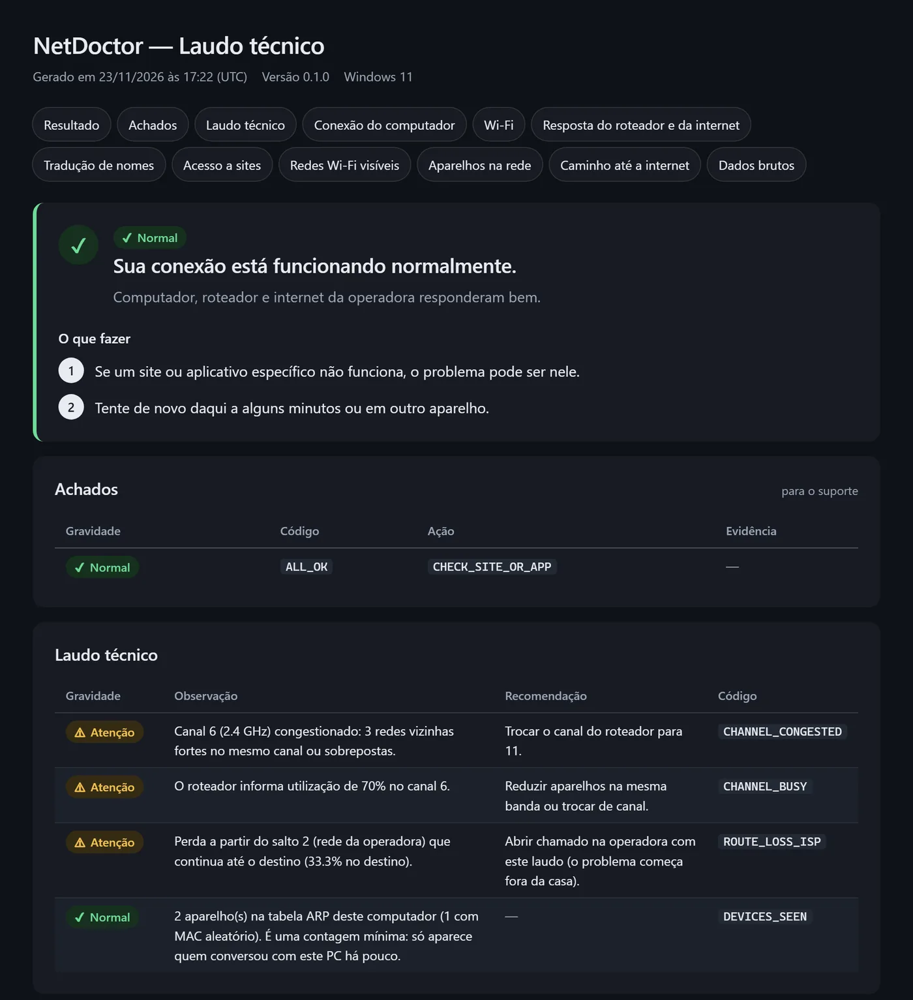

# NetDoctor

Diagnóstico de internet para Windows que explica a causa do problema em português simples.

Autor: Bruno Strapazzon · [portfólio](https://brunostrapazzon.github.io) · [LinkedIn](https://www.linkedin.com/in/brunostrapazzon)

> **Status:** os 7 marcos da v1 estão prontos: interface gráfica do Modo Cliente, testes de rede (incluindo Wi-Fi), regras de diagnóstico, explicação em português simples (offline, com IA opcional), relatórios JSON/HTML, `.exe` gerado pelo PyInstaller e Modo Técnico com laudo (pela linha de comando).

| Relatório do cliente | Laudo técnico (Modo Técnico) |
|---|---|
|  |  |

<sub>Gerados com os dados de teste do projeto, não de uma rede real. Download e versão mais recente na página de [Releases](https://github.com/brunostrapazzon/NetDoctor/releases/latest).</sub>

## O problema

Trabalho há cerca de 3 anos com suporte de TI e redes num representante de provedor de internet. A maioria dos chamados "minha internet não funciona" é Wi-Fi fraco, roteador travado ou DNS, e não falha da operadora. Só que descobrir isso hoje exige um técnico. O NetDoctor faz essa triagem sozinho e diz ao usuário o que fazer.

## Como baixar e usar

1. Na página de **Releases** do repositório, baixe `NetDoctor.exe`.
2. Dê dois cliques. Não precisa instalar nada nem ser administrador.
3. Clique em **Diagnosticar**.

Também há o `netdoctor-cli.exe`, para quem prefere o terminal: `netdoctor-cli.exe diagnose --html relatorio.html`. O Modo Técnico, para quem dá suporte, roda com `netdoctor-cli.exe tech --html laudo.html`.

**Aviso do Windows (SmartScreen):** o executável não é assinado digitalmente (um certificado custa caro para um projeto pessoal). Na primeira vez o Windows pode mostrar "O Windows protegeu o computador". Clique em **Mais informações** e em **Executar assim mesmo**. Para conferir se o arquivo é o original, compare o hash com o `SHA256SUMS.txt` do release:

```powershell
Get-FileHash .\NetDoctor.exe -Algorithm SHA256
```

Para usar a IA opcional com o `.exe`, coloque o `.env` em `%APPDATA%\NetDoctor\.env` (ver [IA opcional](#ia-opcional)).

## Como usar (a partir do código-fonte)

Requer Windows 10/11 e Python 3.11+. Não precisa de administrador.

```powershell
py -3.12 -m venv .venv
.venv\Scripts\pip install -e ".[dev]"

.venv\Scripts\netdoctor-gui                       # interface gráfica (Modo Cliente)
.venv\Scripts\netdoctor diagnose                  # explicação + detalhes técnicos
.venv\Scripts\netdoctor diagnose --json           # relatório JSON completo
.venv\Scripts\netdoctor diagnose -o rel.json      # salva o relatório JSON
.venv\Scripts\netdoctor diagnose --html rel.html  # salva o relatório HTML para o suporte
.venv\Scripts\netdoctor diagnose --sem-ia         # ignora a IA mesmo se configurada
.venv\Scripts\netdoctor tech --html laudo.html    # Modo Técnico: laudo com canais, aparelhos e saltos
```

### IA opcional

Tudo funciona sem IA. Para que uma IA reescreva a explicação de forma mais natural, copie [`.env.example`](.env.example) para `.env` (na pasta atual ou em `%APPDATA%\NetDoctor\`) e preencha:

```ini
NETDOCTOR_LLM_PROVIDER=groq        # groq | openai | ollama | none
NETDOCTOR_LLM_MODEL=<modelo>       # confira os disponíveis no console do provedor
NETDOCTOR_LLM_API_KEY=<sua chave>  # não precisa para Ollama local
```

Se a IA falhar por qualquer motivo (sem chave, sem internet, demora, resposta estranha), o NetDoctor usa o texto offline sem mostrar erro.

Exemplo de saída:

```
Seu Wi-Fi está fraco neste lugar.
O sinal chega fraco ao computador, e isso deixa a internet lenta ou instável.
Força do sinal: 38% (o ideal é acima de 50%).

O que fazer:
  1. Aproxime-se do roteador ou tire obstáculos do caminho (paredes, móveis, espelhos).
  2. Se puder, use cabo de rede.
  3. Se precisa de Wi-Fi forte neste cômodo, peça ao suporte uma avaliação de repetidor.

--- Detalhes técnicos ---
Diagnóstico: WIFI_WEAK (warning) -> ação MOVE_CLOSER_OR_USE_CABLE
[adapter] wifi | IP 192.168.0.10 | gateway 192.168.0.1
[wifi] sinal 38% (-81 dBm) | canal 36 | 5 GHz | 802.11ac
[ping] gateway: perda 0.0%, média 1.2 ms | public_cloudflare: perda 0.0%, média 18.8 ms | ...
[dns] configured 203.0.113.53: ok 12.5 ms | public 1.1.1.1: ok 21.4 ms | ...
[http] teste Windows: ok | HTTPS: ok
```

## Arquitetura

```
probes (fatos) ──► regras (diagnóstico) ──► explicação (texto leigo) ──► relatório / interface
 adapter, wifi,     determinísticas e          templates pt-BR offline;
 ping, dns, http    testáveis                  IA opcional (Marco 5)
```

| Probe | O que mede | Como |
|---|---|---|
| `adapter` | Adaptador ativo, tipo (Wi-Fi/cabo), IP, gateway, DNS configurado, IP 169.254 (sem DHCP) | Cmdlets do PowerShell com saída JSON. Não depende do idioma do Windows. |
| `wifi` | Sinal (%), RSSI, canal, banda, padrão | `netsh wlan show interfaces` com tabela de rótulos PT/EN. Detecta falta de permissão de Localização (Windows 11 24H2+) e orienta o usuário. Não roda em conexão por cabo. |
| `ping` | Perda e latência até o roteador, 1.1.1.1 e 8.8.8.8 | `ping.exe`; parsing pela marca `TTL=`, igual em PT e EN |
| `dns` | Se o DNS configurado e os públicos resolvem um nome, e em quanto tempo | Consulta direta a cada servidor (`dnspython`) |
| `http` | Portal cativo e bloqueio de HTTPS | Teste NCSI do Windows + endpoint HTTPS que devolve 204, sem seguir redirecionamentos |

As probes rodam com tempo limite, em paralelo depois do adaptador. Uma probe que falha vira "não foi possível medir" e nunca derruba o diagnóstico.

### Motor de regras

O primeiro ponto de falha na cadeia é a causa provável:

| Código | Quando | Ação |
|---|---|---|
| `NO_LINK` | Nenhum adaptador conectado | Verificar cabo / ligar o Wi-Fi |
| `NO_DHCP` | IP 169.254.x.x ou sem IP | Reiniciar o roteador |
| `GATEWAY_DOWN` | Roteador não responde e nada da internet responde, ou não há rota padrão | Reiniciar o roteador |
| `ISP_DOWN` | Roteador ok; ping público, HTTPS e teste do Windows sem resposta | Ligar para a operadora |
| `DNS_FAIL` | Internet responde, DNS configurado falha, DNS público ok | Trocar o DNS |
| `CAPTIVE_PORTAL` | Teste do Windows redirecionado/alterado ou HTTPS interceptado | Abrir a página de login da rede |
| `WIFI_WEAK` | Sinal < 50% | Aproximar-se do roteador ou usar cabo |
| `LOCAL_INTERFERENCE` | Perda ≥ 20% ou média ≥ 50 ms já até o roteador | Reiniciar o roteador / reduzir o uso |
| `ALL_OK` | Nada acima, com tudo medido | O problema pode ser no site ou app |
| `INCONCLUSIVE` | Nada acima, mas algum teste essencial não mediu | Rodar de novo |

Os limiares ficam em [`netdoctor/core/thresholds.toml`](netdoctor/core/thresholds.toml), com a justificativa de cada valor. Cada regra tem testes de disparo, de limite do limiar, de prioridade na cadeia e de "teste não mediu", com saídas do ping em PT e EN.

### Explicação e relatórios

- **Explicação offline** ([`explain/templates.py`](netdoctor/explain/templates.py)): para cada código, uma frase de causa, um detalhe e de 1 a 3 ações, sem jargão (um teste barra palavras como "gateway", "DNS", "IP"). Achados secundários aparecem como "Também notamos: …".
- **Relatório JSON**: diagnóstico, explicação e todos os fatos medidos.
- **Relatório HTML**: um único arquivo, sem nada externo (sem fontes da web, sem JavaScript), que abre offline em qualquer navegador e pode ser anexado num chamado. Começa pelo resultado (selo ✔/⚠/✖ com texto, o que fazer em passos numerados), depois os achados, o laudo técnico quando houver, uma tabela por teste e o JSON bruto recolhido. Tem sumário com atalhos para cada seção, tema claro e escuro automático, tabelas com números alinhados que rolam de lado no celular, foco visível para teclado e versão para impressão.

### Interface (Modo Cliente)

Parece um utilitário do Windows, não um site: fonte do sistema (Segoe UI), cores do sistema do Windows 11 nos temas claro e escuro, sem cartões, selos ou emoji. Os botões ficam embaixo, com **Diagnosticar** à direita, como numa caixa de diálogo; Enter também aciona. Durante o teste, uma barra avança uma etapa por vez e cada etapa mostra o próprio status ("testando…", "ok", "não mediu", "não se aplica"). No resultado, uma faixa de cor ao lado do texto e a palavra da gravidade (Normal, Atenção, Problema), então a cor nunca é a única pista. Depois vêm a explicação e o que fazer. **Salvar relatório…** grava o HTML e uma cópia `.json` para o suporte. **Copiar resumo** copia só a explicação e os códigos, sem nome da rede nem endereços, pronto para colar no WhatsApp.

**Por que CustomTkinter:** é leve, roda sobre o Tkinter que já vem com o Python, tem tema claro/escuro automático e escala bem em telas HiDPI. O PyInstaller tem hook oficial para ele, o que mantém o `.exe` pequeno. PySide6/Qt deixaria o executável dezenas de MB maior e complica a licença; Tkinter puro tem visual datado.

O diagnóstico roda numa thread separada e conversa com a janela por uma fila, então a tela nunca trava. A lógica da tela (textos, resumo, thread) e a própria janela, montada com widgets falsos que validam cada parâmetro contra o CustomTkinter instalado, têm testes que não abrem janela.

### Modo Técnico (`netdoctor tech`)

Para quem dá suporte. Roda o mesmo diagnóstico do Modo Cliente e, em paralelo, mais três probes. Gera um **laudo técnico** (texto, JSON ou HTML) em cerca de 15 s. No pior caso o `tracert` leva até 30 s.

| Probe | O que mede | Como |
|---|---|---|
| `neighbors` | Redes Wi-Fi visíveis: banda, canal, sinal e, se o roteador informar, a utilização do canal e quantos aparelhos estão nele | `netsh wlan show networks mode=bssid` (PT/EN). Lê a lista que o Windows já tem e **não guarda nome nem BSSID das redes vizinhas** |
| `devices` | Aparelhos na rede: IP, MAC, qual é o roteador, MAC aleatório (celulares) | `Get-NetNeighbor` (tabela ARP). **Passivo**: só lê o cache, não varre a rede |
| `hops` | Latência e perda por salto até 1.1.1.1 | `tracert -d` (sem resolver nomes), parsing igual em PT e EN |

O laudo traz achados determinísticos, com limiares no mesmo [`thresholds.toml`](netdoctor/core/thresholds.toml):

| Código | Quando | Recomendação |
|---|---|---|
| `CHANNEL_CONGESTED` | 3+ redes vizinhas fortes (sinal ≥ 50%) no mesmo canal, ou sobrepostas em 2,4 GHz | Trocar para o canal menos disputado (1/6/11 em 2,4 GHz; 36–48 e 149–161 em 5 GHz) |
| `CHANNEL_BUSY` | O roteador informa utilização do canal ≥ 60% | Reduzir aparelhos na banda ou trocar de canal |
| `ROUTE_LOSS_LOCAL` / `ROUTE_LOSS_ISP` | Perda que começa num salto e **continua até o destino** | Rede local, ou chamado na operadora |
| `ROUTE_LATENCY_ISP` | Latência +60 ms em relação ao roteador, a partir de um salto e até o destino | Chamado na operadora |
| `ROUTE_INCOMPLETE` | O `tracert` não chegou ao destino | Só informativo (pode ser filtro de ICMP) |
| `CHANNEL_OK`, `ROUTE_OK`, `DEVICES_SEEN` | Informativos | — |

Perda ou atraso num salto do meio que **some nos saltos seguintes** é ignorado: é o roteador do caminho dando baixa prioridade a ICMP, um falso alarme clássico de `tracert`. O que é local e o que é da operadora se decide pelo endereço do roteador, não pela faixa do IP, porque operadoras usam IPs privados e CGNAT por dentro.

O Modo Técnico **não muda o diagnóstico do cliente** e nada dele vai para a IA.

### Por que a IA não decide o diagnóstico

O diagnóstico vem de regras fixas e testadas. A IA (opcional) só reescreve em linguagem simples um resultado que já foi decidido: ela recebe o código do achado e o texto offline como base, e devolve uma frase e de 1 a 3 ações, que são validadas antes de aparecer. Assim o resultado é reproduzível, funciona sem internet (justamente quando o usuário mais precisa) e não depende do humor de um modelo. Quando a IA reescreve, a tela avisa.

Provedores suportados: Groq, OpenAI e Ollama local, todos pela API compatível com a da OpenAI, sem SDK. Trocar de provedor é só configuração. Sem internet, o provedor na nuvem nem é chamado; o Ollama local continua funcionando.

## Privacidade

- O relatório fica só no seu computador. Ele contém o nome do Wi-Fi e endereços locais; envie apenas ao suporte em quem você confia.
- Endereços contatados pelos testes: o seu roteador, os servidores DNS configurados, `1.1.1.1` e `8.8.8.8` (ping e DNS), `www.msftconnecttest.com` (o mesmo teste que o próprio Windows faz) e `www.google.com/generate_204`.
- **IA desligada por padrão.** Se você configurar uma, ela recebe só: o código do achado (ex.: `WIFI_WEAK`), a gravidade, o tipo de conexão (Wi-Fi/cabo), números (sinal %, perda %, tempo em ms) e o texto offline como base. **Nunca** nome da rede, MAC, endereços IP, nome do computador ou do adaptador. Isso é garantido por uma lista fechada de campos permitidos e por testes. Também foi conferido de ponta a ponta com os dados reais de uma máquina.
- A chave da IA fica só no seu `.env`, que não vai para o repositório.
- **Modo Técnico:** só analisa a rede à qual o computador está conectado. Das redes vizinhas, registra só canal, banda e sinal, nunca o nome ou o BSSID. A lista de aparelhos vem do cache do Windows, sem varredura. O laudo tem os MACs dos aparelhos da sua rede e os IPs do caminho até a internet. Ele fica no seu computador, como o relatório.

## Desenvolvimento

```powershell
.venv\Scripts\python -m pytest
.venv\Scripts\ruff check .
.venv\Scripts\ruff format --check .
```

Os testes usam saídas reais (anonimizadas) dos comandos em `tests/fixtures/` e não dependem da rede.

### Gerar o `.exe`

```powershell
.venv\Scripts\pip install -e ".[build]"
.venv\Scripts\pyinstaller --noconfirm --clean packaging\netdoctor.spec
```

Saem dois arquivos únicos em `dist\`: `NetDoctor.exe` (interface, sem console, ~13 MB) e `netdoctor-cli.exe` (~9 MB). A receita está em [`packaging/netdoctor.spec`](packaging/netdoctor.spec), com ícone e informações de versão do Windows.

**GitHub Actions:** [`ci.yml`](.github/workflows/ci.yml) roda lint e testes no Windows a cada push. [`release.yml`](.github/workflows/release.yml), ao receber uma tag `vX.Y.Z`, confere se ela bate com a versão do pacote, testa, gera os dois `.exe`, faz um teste rápido do executável e publica o release com o `SHA256SUMS.txt`.

## Limitações conhecidas

- Os exemplos de saída em inglês (`ping`, `netsh`) e as mensagens de falta de Localização (PT e EN) foram montados a partir do formato conhecido, não capturados. Falta capturar num Windows em inglês e com a Localização desligada.
- Ainda não foi testado com a rede desligada nem em rede com portal cativo real.
- A probe `adapter` leva de 3 a 7 s porque o PowerShell precisa carregar os módulos de rede.
- O `.exe` não é assinado, então o SmartScreen avisa na primeira execução. Como é `--onefile`, ele se extrai numa pasta temporária a cada abertura, o que leva 1 ou 2 segundos.
- Modo Técnico:
  - Só pela linha de comando; a interface gráfica ainda não tem o botão.
  - As saídas em inglês do `netsh wlan show networks` e do `tracert`, e o caso com várias redes vizinhas, foram montados a partir do formato real, não capturados.
  - Em 5 GHz não considera canais de 40/80 MHz (só disputa no mesmo canal).
  - A utilização do canal só aparece se o roteador anunciar BSS Load.
  - A contagem de aparelhos é mínima: só aparece quem conversou com o computador há pouco.

## Roadmap

1. ✅ Núcleo + CLI
2. ✅ Regras de diagnóstico + testes PT/EN
3. ✅ Wi-Fi, explicações offline, relatórios JSON e HTML
4. ✅ Interface do Modo Cliente
5. ✅ IA opcional com fallback
6. ✅ `.exe` via PyInstaller + GitHub Actions
7. ✅ Modo Técnico (CLI)

---

## English summary

NetDoctor is a Windows tool that diagnoses home/office internet problems and explains the cause in plain Portuguese. It grew out of three years of ISP field support, where most "my internet is down" tickets turn out to be weak Wi-Fi, a stuck router or DNS. Diagnosis comes from deterministic, tested rules. An optional LLM only rewrites the already-decided result, and everything works offline. Current status: all 7 milestones done, including a technician mode (`netdoctor tech`: channel congestion from nearby networks without storing their names, passive ARP device list, per-hop tracert analysis that ignores ICMP-deprioritizing middle hops, HTML report); single-file `.exe` built with PyInstaller and released by GitHub Actions; CustomTkinter one-click client UI on top of probes incl. Wi-Fi signal, a deterministic rule engine, offline Portuguese explanations with an optional LLM rewrite (Groq/OpenAI/Ollama via the OpenAI-compatible API, allowlist-only payload, silent fallback) and self-contained JSON/HTML reports; CLI also available). License: PolyForm Noncommercial 1.0.0 (free for non-commercial use; commercial use requires a license from the author).

## Licença

PolyForm Noncommercial 1.0.0. Ver [LICENSE](LICENSE).

Você pode usar, estudar e modificar o NetDoctor de graça para fins não comerciais: uso pessoal, estudo, pesquisa, escolas e entidades sem fins lucrativos. Uso comercial, como um provedor de internet ou uma empresa que ofereça o NetDoctor aos clientes ou ao próprio suporte, precisa de uma licença comercial: fale comigo pelo GitHub ([brunostrapazzon](https://github.com/brunostrapazzon)).
