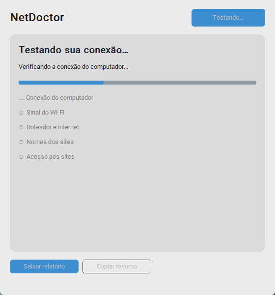
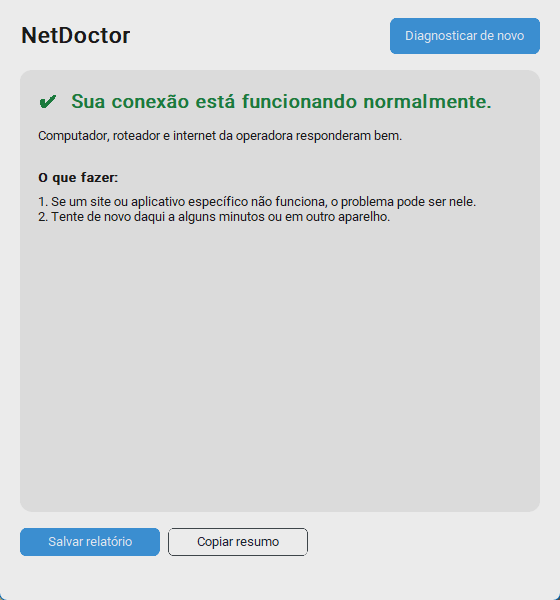
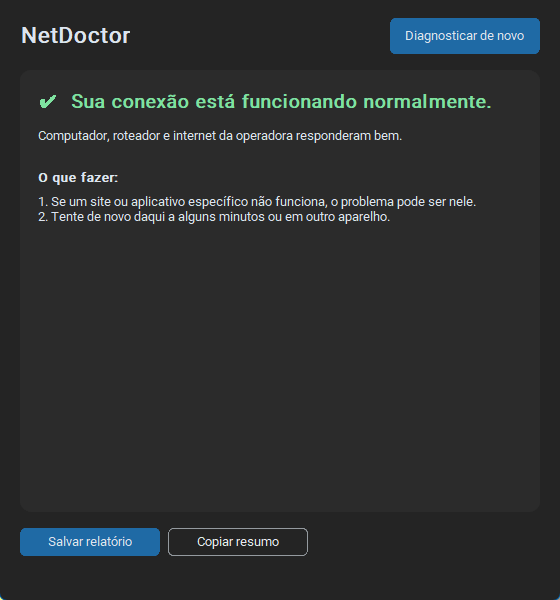

# NetDoctor

Diagnóstico de internet para Windows que explica a causa do problema em português simples.

> **Status:** Marco 4 de 7: interface gráfica do Modo Cliente, testes de rede (incluindo Wi-Fi), regras de diagnóstico, explicação em português simples e relatórios JSON/HTML. Ainda sem `.exe` (roda a partir do código-fonte).

| Testando | Resultado (tema claro) | Resultado (tema escuro) |
|---|---|---|
|  |  |  |

## O problema

Trabalho há cerca de 3 anos com suporte de TI e redes num representante de provedor de internet. A maioria dos chamados "minha internet não funciona" é Wi-Fi fraco, roteador travado ou DNS, e não falha da operadora. Só que descobrir isso hoje exige um técnico. O NetDoctor faz essa triagem sozinho e diz ao usuário o que fazer.

## Como usar (a partir do código-fonte)

Requer Windows 10/11 e Python 3.11+. Não precisa de administrador.

```powershell
py -3.12 -m venv .venv
.venv\Scripts\pip install -e ".[dev]"

.venv\Scripts\netdoctor-gui                       # interface gráfica (Modo Cliente)
.venv\Scripts\netdoctor diagnose                  # explicação + detalhes técnicos
.venv\Scripts\netdoctor diagnose --json           # relatório JSON completo
.venv\Scripts\netdoctor diagnose -o rel.json      # salva o relatório JSON
.venv\Scripts\netdoctor diagnose --html rel.html  # salva o relatório HTML para o suporte
```

Exemplo de saída:

```
Seu Wi-Fi está fraco neste lugar.
O sinal chega fraco ao computador, e isso deixa a internet lenta ou instável.
Força do sinal: 38% (o ideal é acima de 50%).

O que fazer:
  1. Aproxime-se do roteador ou tire obstáculos do caminho (paredes, móveis, espelhos).
  2. Se puder, use cabo de rede.
  3. Se precisa de Wi-Fi forte neste cômodo, peça ao suporte uma avaliação de repetidor.

--- Detalhes técnicos ---
Diagnóstico: WIFI_WEAK (warning) -> ação MOVE_CLOSER_OR_USE_CABLE
[adapter] wifi | IP 192.168.0.10 | gateway 192.168.0.1
[wifi] sinal 38% (-81 dBm) | canal 36 | 5 GHz | 802.11ac
[ping] gateway: perda 0.0%, média 1.2 ms | public_cloudflare: perda 0.0%, média 18.8 ms | ...
[dns] configured 203.0.113.53: ok 12.5 ms | public 1.1.1.1: ok 21.4 ms | ...
[http] teste Windows: ok | HTTPS: ok
```

## Arquitetura

```
probes (fatos) ──► regras (diagnóstico) ──► explicação (texto leigo) ──► relatório / interface
 adapter, wifi,     determinísticas e          templates pt-BR offline;
 ping, dns, http    testáveis                  IA opcional (Marco 5)
```

| Probe | O que mede | Como |
|---|---|---|
| `adapter` | Adaptador ativo, tipo (Wi-Fi/cabo), IP, gateway, DNS configurado, IP 169.254 (sem DHCP) | Cmdlets do PowerShell com saída JSON. Não depende do idioma do Windows. |
| `wifi` | Sinal (%), RSSI, canal, banda, padrão | `netsh wlan show interfaces` com tabela de rótulos PT/EN. Detecta falta de permissão de Localização (Windows 11 24H2+) e orienta o usuário. Não roda em conexão por cabo. |
| `ping` | Perda e latência até o roteador, 1.1.1.1 e 8.8.8.8 | `ping.exe`; parsing pela marca `TTL=`, igual em PT e EN |
| `dns` | Se o DNS configurado e os públicos resolvem um nome, e em quanto tempo | Consulta direta a cada servidor (`dnspython`) |
| `http` | Portal cativo e bloqueio de HTTPS | Teste NCSI do Windows + endpoint HTTPS que devolve 204, sem seguir redirecionamentos |

As probes rodam com tempo limite, em paralelo depois do adaptador. Uma probe que falha vira "não foi possível medir" e nunca derruba o diagnóstico.

### Motor de regras

O primeiro ponto de falha na cadeia é a causa provável:

| Código | Quando | Ação |
|---|---|---|
| `NO_LINK` | Nenhum adaptador conectado | Verificar cabo / ligar o Wi-Fi |
| `NO_DHCP` | IP 169.254.x.x ou sem IP | Reiniciar o roteador |
| `GATEWAY_DOWN` | Roteador não responde e nada da internet responde, ou não há rota padrão | Reiniciar o roteador |
| `ISP_DOWN` | Roteador ok; ping público, HTTPS e teste do Windows sem resposta | Ligar para a operadora |
| `DNS_FAIL` | Internet responde, DNS configurado falha, DNS público ok | Trocar o DNS |
| `CAPTIVE_PORTAL` | Teste do Windows redirecionado/alterado ou HTTPS interceptado | Abrir a página de login da rede |
| `WIFI_WEAK` | Sinal < 50% | Aproximar-se do roteador ou usar cabo |
| `LOCAL_INTERFERENCE` | Perda ≥ 20% ou média ≥ 50 ms já até o roteador | Reiniciar o roteador / reduzir o uso |
| `ALL_OK` | Nada acima, com tudo medido | O problema pode ser no site ou app |
| `INCONCLUSIVE` | Nada acima, mas algum teste essencial não mediu | Rodar de novo |

Os limiares ficam em [`netdoctor/core/thresholds.toml`](netdoctor/core/thresholds.toml), com a justificativa de cada valor. Cada regra tem testes de disparo, de limite do limiar, de prioridade na cadeia e de "teste não mediu", com saídas do ping em PT e EN.

### Explicação e relatórios

- **Explicação offline** ([`explain/templates.py`](netdoctor/explain/templates.py)): para cada código, uma frase de causa, um detalhe e de 1 a 3 ações, sem jargão (um teste barra palavras como "gateway", "DNS", "IP"). Achados secundários aparecem como "Também notamos: …".
- **Relatório JSON**: diagnóstico, explicação e todos os fatos medidos.
- **Relatório HTML**: um único arquivo, sem nada externo, que abre offline em qualquer navegador e pode ser anexado num chamado. Tem tema claro e escuro.

### Interface (Modo Cliente)

Um botão **Diagnosticar**, uma lista de etapas que vai sendo marcada (✔) conforme cada teste termina e, no fim, o resultado com ícone e cor (✔ normal, ⚠ atenção, ✖ problema) e o que fazer. **Salvar relatório** grava o HTML e uma cópia `.json` para o suporte. **Copiar resumo** copia só a explicação e os códigos, sem nome da rede nem endereços, pronto para colar no WhatsApp.

**Por que CustomTkinter:** é leve, roda sobre o Tkinter que já vem com o Python, tem tema claro/escuro automático e escala bem em telas HiDPI. O PyInstaller tem hook oficial para ele, o que mantém o `.exe` pequeno. PySide6/Qt deixaria o executável dezenas de MB maior e complica a licença; Tkinter puro tem visual datado.

O diagnóstico roda numa thread separada e conversa com a janela por uma fila, então a tela nunca trava. A lógica da tela (textos, resumo, thread) tem testes que não precisam abrir janela.

### Por que a IA não decide o diagnóstico

O diagnóstico vem de regras fixas e testadas. A IA (opcional, Marco 5) só reescreve em linguagem simples um resultado que já foi decidido. Assim o resultado é reproduzível, funciona sem internet (justamente quando o usuário mais precisa) e não depende do humor de um modelo.

## Privacidade

- O relatório fica só no seu computador. Ele contém o nome do Wi-Fi e endereços locais; envie apenas ao suporte em quem você confia.
- Endereços contatados pelos testes: o seu roteador, os servidores DNS configurados, `1.1.1.1` e `8.8.8.8` (ping e DNS), `www.msftconnecttest.com` (o mesmo teste que o próprio Windows faz) e `www.google.com/generate_204`.
- Nada é enviado para a IA nesta versão. Quando ela entrar, vai receber só os códigos e números do diagnóstico, nunca nome da rede, MAC, IP ou nome do computador.

## Desenvolvimento

```powershell
.venv\Scripts\python -m pytest
.venv\Scripts\ruff check .
.venv\Scripts\ruff format --check .
```

Os testes usam saídas reais (anonimizadas) dos comandos em `tests/fixtures/` e não dependem da rede.

## Limitações conhecidas

- Os exemplos de saída em inglês (`ping`, `netsh`) e as mensagens de falta de Localização (PT e EN) foram montados a partir do formato conhecido, não capturados. Falta capturar num Windows em inglês e com a Localização desligada.
- Ainda não foi testado com a rede desligada nem em rede com portal cativo real.
- A probe `adapter` leva de 3 a 7 s porque o PowerShell precisa carregar os módulos de rede.

## Roadmap

1. ✅ Núcleo + CLI
2. ✅ Regras de diagnóstico + testes PT/EN
3. ✅ Wi-Fi, explicações offline, relatórios JSON e HTML
4. ✅ Interface do Modo Cliente
5. IA opcional com fallback
6. `.exe` via PyInstaller + GitHub Actions
7. Modo Técnico

---

## English summary

NetDoctor is a Windows tool that diagnoses home/office internet problems and explains the cause in plain Portuguese. It grew out of three years of ISP field support, where most "my internet is down" tickets turn out to be weak Wi-Fi, a stuck router or DNS. Diagnosis comes from deterministic, tested rules. An optional LLM only rewrites the already-decided result, and everything works offline. Current status: milestone 4 (CustomTkinter one-click client UI on top of probes incl. Wi-Fi signal, a deterministic rule engine, offline Portuguese explanations and self-contained JSON/HTML reports; CLI also available).

## Licença

PolyForm Noncommercial 1.0.0. Ver [LICENSE](LICENSE).

Você pode usar, estudar e modificar o NetDoctor de graça para fins não comerciais: uso pessoal, estudo, pesquisa, escolas e entidades sem fins lucrativos. Uso comercial, como um provedor de internet ou uma empresa que ofereça o NetDoctor aos clientes ou ao próprio suporte, precisa de uma licença comercial: fale comigo pelo GitHub ([brunostrapazzon](https://github.com/brunostrapazzon)).
